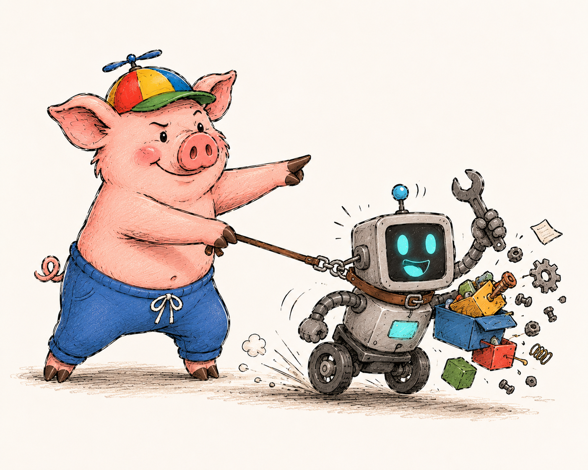

# AI-Assisted Development

<p align="center">
  
</p>

AI coding agents can significantly speed up development.

At the same time, without proper engineering constraints they often introduce:

- unnecessary abstractions
- duplicated logic
- unrelated refactoring
- inconsistent architecture
- unstable code quality

AI should accelerate implementation, not replace engineering responsibility. The developer is still responsible for
architecture, correctness, maintainability, security and code quality.

This document describes practical approaches for using AI coding agents in real-world projects. Nothing here depends
on a specific agent: the same setup works for Claude Code, Codex or any other client.

## Quality Gates First

Before integrating AI into your workflow, make sure your project already has strong quality gates.

The main idea: **a commit or a push that breaks the rules must not go through.** Gates enforced by git hooks do not care
who wrote the code. They work the same way for a developer, for Claude, for Codex, or for an agent that ignored its
instructions. That makes them more reliable than any agent-side hook, which only exists in one tool and only protects
what it was configured to protect.

Agents adapt quickly to a strict pipeline: a rejected commit returns the exact error, the agent fixes it and tries
again. The better your validation pipeline is, the better the generated code becomes.

At minimum, your project should include:

- strict TypeScript configuration
- ESLint and Prettier
- a pre-commit hook for fast checks on staged files
- a pre-push hook for slower checks on the whole project
- CI checks

This repository uses Husky with three hooks:

| Hook         | What it runs                                                                                       |
| ------------ | -------------------------------------------------------------------------------------------------- |
| `pre-commit` | lint-staged: Prettier and `eslint --fix` on staged files, `tsc --noEmit` for every touched package |
| `commit-msg` | commitlint (conventional commits) and a check that rejects AI attribution trailers                 |
| `pre-push`   | Knip (unused files, exports and dependencies) and all unit tests                                   |

The `commit-msg` hook is a good example of a rule that belongs in a gate, not in instructions: an agent may forget a
line in `AGENTS.md`, but it cannot commit a message the hook rejects.

Your CI pipeline should validate:

- linting
- formatting
- type checking
- unit tests
- e2e tests
- visual regression tests
- accessibility tests

Storybook is an important part of the frontend quality pipeline. It provides a visual playground for components, makes
it easy to review UI in isolation, and is the foundation for visual regression and accessibility testing.

The goal is simple: low-quality code should not be able to enter the repository.

## Architecture Before Generation

AI performs much better when the project structure already exists. Agents are pattern-oriented: they copy what they
see. Consistent code produces consistent output, mixed styles produce more mixed styles.

Before generating features with AI, define folder structure, naming conventions, module boundaries and core
abstractions. Then do two more things:

- **Write the architecture down.** A structure that lives only in the code has to be rediscovered by the agent in every
  session. A short description in `docs/` (see [Workflow](#workflow)) is read once and followed.
- **Keep one reference implementation per pattern.** Point the agent at it explicitly: "build the new feature the way
  `packages/core/src/features/todos/` is built". One good example beats a page of rules.

This project demonstrates that approach. The layers (`packages/core` for state and API clients, `packages/ui-web` for
components, `apps/web-client` for pages and routing), naming conventions and `AGENTS.md` rules were established before
any AI-assisted feature generation, so generated code fits the existing architecture without manual correction.

## Workflow

The core idea: **the agent needs the most detailed description possible of the project and of the current tasks.** An
agent that knows the goal, the architecture, the constraints and the plan makes far fewer wrong guesses than one that
reverse-engineers them from the code.

### Context belongs to the repository

Context that lives in a chat history, in one developer's head or in one tool's private memory is lost at the next
session. Keep it in the repository:

- **All project context lives in `docs/` at the repository root.** Any client (Claude Code, Codex, another agent, a new
  team member) can read it, and it is versioned together with the code it describes.
- **Add `docs/` to `.prettierignore`.** These files are written for agents and edited by agents; Prettier has broken
  their structure before (tables, nested lists, checkboxes). The human guide stays formatted as usual.
- **Keep the rules in `AGENTS.md`, and make `CLAUDE.md` point to it.** Codex and most other agents read `AGENTS.md`;
  Claude Code reads `CLAUDE.md`, which needs only one line: `@AGENTS.md`. One set of rules, no copies to keep in sync.

### What goes into AGENTS.md

`AGENTS.md` should not describe the obvious. Modern models read `package.json`, the folder tree and the configs
themselves, so a list of dependencies or scripts in `AGENTS.md` only adds tokens and goes stale.

Write what the agent cannot infer from the code:

- what the project should look like and what quality bar it must meet
- non-obvious nuances and constraints
- how to work with the documentation in `docs/`

For example:

```markdown
## Planning

Before writing a new plan, read `docs/goal.md`, `docs/architecture/` and `docs/restrictions/`.
Every plan goes to `docs/plans/`, names its target version and keeps a status per task.

## Documentation Rules

After every change, update the affected files in `docs/`. When you take a shortcut that a reader would not expect,
record it in `docs/hacks/`.
```

### The docs/ folder

A layout that works well:

```
docs/
├── goal.md          # what the project is and what it must achieve
├── architecture/    # overall architecture of the project
├── commands.md      # commands you or your agent use to work with the project
├── restrictions/    # constraints of this project
├── plans/           # what you are implementing now
├── ideas/           # raw, high-level ideas, not ready for work
├── roadmap/         # ideas worked out into future versions
├── benchmarks/      # performance results and notes (optional)
├── open-issues/     # known problems that are deferred
├── postmortem/      # attempts that did not work, and why
└── hacks/           # non-obvious decisions and shortcuts
```

Start small: a single file is fine until it grows, then turn it into a folder.

- **architecture** — the overall architecture: layers, module boundaries, data flow, key decisions.
- **commands.md** — the commands you or your agent run to work with the project, with a one-line purpose each. See the
  example below.
- **restrictions** — every project has its constraints: a dependency that cannot be upgraded, an API that must stay
  backward compatible, a platform that is not supported. Write them down once instead of running into them every time.
- **plans** — the most important folder: what you are implementing. A plan contains sub-plans and tasks, their
  priorities, an overall status and a status per task, and ideally the version it ships in. See the example below.
- **ideas** — your ideas at a very high level, while they are not ready for work.
- **roadmap** — ideas that have been worked out. Here you shape future versions and decide which features they include.
- **benchmarks** — useful when the project has metrics. Save the results before every release, and later you can see
  where performance dropped and when.
- **open-issues** — deferred open problems, so they are not rediscovered (or silently "fixed") in every session.
- **postmortem** — something you tried that did not help. Keep it for history: the problem (link the open issue), what
  was tried and the negative result. It stops the next session from repeating the same attempt.
- **hacks** — an important folder: every place where you cut a corner or made a non-obvious decision, and why. Without
  it, the agent "cleans up" exactly the code that must stay as it is.

With this context in place, the agent operates on facts instead of guesses.

Example `commands.md`:

````markdown
# Commands

## Development

```bash
npm run dev            # web client on http://localhost:5173
npm run dev:mobile     # Expo dev server for the mobile client
npm run storybook      # component playground
```

## Checks

```bash
npm run lint           # ESLint in every project
npm test               # unit tests in every project
npm run test:e2e       # Playwright e2e for the web client
npm run full-check     # everything CI would run; use before a release
```

## Rules

- For an isolated change, run only the tests of the affected project: `npx nx test core`.
- Never run `npm run release` without an explicit request.
````

Example plan, `docs/plans/1.2.0-notifications.md`:

```markdown
# Notifications

Version: 1.2.0
Status: in progress (2/4 tasks done)

## Goal

Show success and error toasts after API operations.

## Tasks

| #   | Task                                 | Priority | Status  |
| --- | ------------------------------------ | -------- | ------- |
| 1   | Notifications slice and selectors    | P0       | done    |
| 2   | Toast component with Storybook story | P0       | done    |
| 3   | Dispatch toasts from todo thunks     | P1       | in work |
| 4   | Auto-dismiss timing and a11y review  | P2       | todo    |

## Sub-plans

- `1.2.0-notifications-mobile.md`: the same feature for the Expo client.

## Notes

- Restriction: no new dependencies (`docs/restrictions/dependencies.md`).
```

This repository keeps a smaller set today: `architecture.md`, `api.md`, `data-schema.md` and `developers-guide.md` in
[docs/](../docs/), and the roadmap in [roadmap.md](../roadmap.md).

### Tune your harness

The agent is only as effective as the tools around it. Give it small helper scripts for the things it does every day:
show the status of a task or a plan, prepare a review package for a branch, run only the tests affected by a change.
A script is deterministic, cheap to run and produces the same output every time, which a free-form instruction cannot
guarantee.

Repeated actions can also become skills or custom commands of your agent: define them once, invoke them by name. Good
candidates are commits in the project's convention, running a specific test suite or scaffolding a new feature.

### Plan, then implement

For anything beyond a trivial change, plan first:

1. Write the task with enough context: goal, constraints, the reference implementation to follow.
2. Let a strong model produce the plan. Review every point and add what is missing by hand.
3. Save the plan to `docs/plans/` and commit it, linked to the ticket.
4. Implement from the saved plan, task by task, updating the status as you go. A cheaper model is usually enough for
   implementation when the plan is good.

## Pre-Hooks

Agent-side hooks run before the agent uses a tool and can block the action. This repository has Claude Code hooks in
[`.claude/settings.json`](../.claude/settings.json): they deny edits of `package-lock.json`, `.env*`, `CHANGELOG.md`,
`dist/` and `coverage/`, and block `--legacy-peer-deps`, `git push --force` and `git reset --hard`.

They are a useful second line of defence, but they only exist in one tool. Anything that must hold for every agent
belongs in the git hooks described in [Quality Gates First](#quality-gates-first).

## Task Decomposition

Bad prompt:

```text
Add notifications to the app
```

Good prompt:

```text
Context:
React + Redux Toolkit monorepo for a todo application. The notifications feature does not exist yet.
Plan: docs/plans/1.2.0-notifications.md, task 1.

Task:
Create a notifications feature with Redux state.

Details:
- Files in packages/core:
  - src/features/notifications/notifications.types.ts — Notification type (id, message, type: 'success' | 'error')
  - src/features/notifications/notifications.slice.ts — Redux slice with add/remove actions
  - src/features/notifications/notifications.selectors.ts — selectNotifications selector
- Unit tests next to each file

Pattern:
Use packages/core/src/features/todos/ as the structural reference.

Constraints:
- Follow docs/restrictions/
- Do not modify existing features
- Code must pass the pre-commit hook without configuration changes
- Mark the task done in the plan when finished
```

The more specific the task, the better the result. Decompose large tasks into smaller isolated steps whenever possible.

## Common AI Problems

AI-generated code often fails in predictable ways:

- overengineering and unnecessary abstractions
- duplicate utilities
- inconsistent naming
- unrelated refactoring
- ignoring existing architecture
- "fixing" an intentional shortcut
- retrying an approach that already failed

The `docs/` folder addresses most of them directly: `architecture` and a reference implementation keep the structure,
`restrictions` and `hacks` protect deliberate decisions, `postmortem` records what not to try again.

## Cost Optimization

Large context windows increase both token usage and reasoning instability.

To reduce cost and improve output quality:

- read only relevant files
- avoid scanning the entire repository
- run only affected tests
- keep tasks small and isolated

Good documentation is a cost optimization too: an agent that can read `docs/architecture/` and `docs/commands.md` does
not need to explore the repository to find out how it works.

Example **AGENTS.md** section:

```text
## Cost Saving Rules

- Run only affected tests
- Avoid full test suite runs for isolated changes
- Read only files related to the task
- Avoid repository-wide scans unless necessary
```

## Quality Control

AI-generated code should always be reviewed and validated manually.

Even strong AI coding agents can miss edge cases, introduce hidden bugs, misunderstand business logic or produce overly
complex solutions. AI assistance does not remove engineering responsibility.

### Commit Frequently

Each completed task of a plan should become a separate commit. Small commits make it easy to roll back a problematic
change, find where a regression came from and review generated code incrementally.

### Validate Edge Cases

AI often handles the "happy path" well but misses edge cases.

Always verify:

- invalid inputs
- boundary conditions
- error handling
- empty states
- concurrency scenarios
- permission checks

If edge cases are missing, ask the agent to extend the tests, or improve the implementation by hand.

### Mandatory Code Review

AI-generated code goes through the same review as manually written code: personal review, team review and automated
analysis.

A review checklist in the repository ([REVIEW.md](../REVIEW.md) here) gives both people and agents the same criteria.
Tools such as [SonarCloud/SonarQube](https://www.sonarsource.com/products/sonarqube/cloud/) add static analysis on pull
requests; this project includes `eslint-plugin-sonarjs` in its ESLint configuration, so a subset of SonarQube-style
rules runs on every commit through lint-staged.

### Never Trust AI Blindly

If generated code looks unclear or suspicious, ask the agent to explain it, request a simpler implementation, or rewrite
it by hand.

Do not merge code you do not fully understand. The final responsibility for the codebase always belongs to the developer
and the team.

## Recommended Workflow

1. Capture the idea in `docs/ideas/`; when it is worked out, move it to `docs/roadmap/` and assign a version.
2. Write a plan in `docs/plans/` with tasks, priorities, statuses and the target version.
3. Review the plan against `docs/goal.md`, `docs/architecture/` and `docs/restrictions/`, then commit it.
4. Implement task by task; each task ends with a commit that passes the git hooks.
5. Review the generated code after each task and update the task status in the plan.
6. Record what you learned: shortcuts in `docs/hacks/`, deferred problems in `docs/open-issues/`, failed attempts in
   `docs/postmortem/`.
7. Run the full checks and review all changes before opening a pull request.

AI coding agents are most effective when used as controlled engineering accelerators, not autonomous developers.
