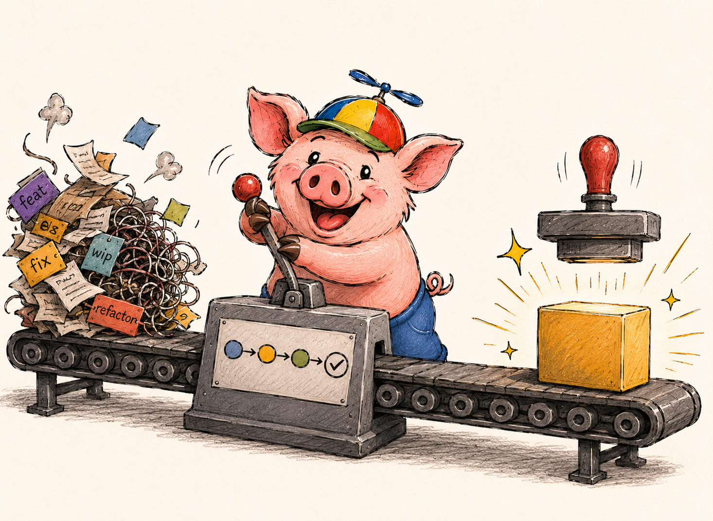

# Development Workflow

<p align="center">
  
</p>

The shared workflow is described in the backend guide: [Development Workflow](https://github.com/prod-forge/backend/blob/main/guide/development-workflow.md). Branch naming (`type/ID-short-description`), [commit conventions](https://github.com/prod-forge/backend/blob/main/guide/development-workflow.md#commit-conventions), the feature and bug fix flow, mandatory code review and squash merge are the same in this repository, and are not repeated here. This chapter lists only what a frontend monorepo adds.

## NX-Aware Development

This monorepo uses NX for task orchestration. Prefer `nx affected` over running everything: it runs only the tasks of the packages affected by your changes, based on the dependency graph.

```shell
npx nx affected -t test
npx nx affected -t lint
npx nx graph
```

Because `core` is a dependency of `ui-web`, `web-client` and `mobile-client`, a change in `core` affects all three, while a change in `ui-web` leaves `mobile-client` alone. For a single project, call it by name: `npx nx test core`, `npx nx storybook ui-web`.

## Visual Snapshots in a Pull Request

If a pull request changes how a component looks, the visual tests fail on purpose. The author does not hide that, and does the following:

1. Run `npm run test:visual` and open the Playwright report to see the actual, expected and diff images.
2. If the change is intended, run `npm run test:visual:update` and look at every changed file in `packages/ui-web/visual-tests/snapshots/`. Each is a screenshot of a story; a changed image is a changed UI.
3. Commit the updated snapshots in the same pull request, so the reviewer sees the code and its visual result together.
4. If the change is not intended, fix the code and leave the snapshots alone.

Snapshots depend on the operating system, and today only `darwin` snapshots are stored. This and the Linux workflow are explained in [Design System](design-system.md#snapshots-are-per-platform). Never regenerate snapshots to make a failing test pass without looking at the diff: that is what the test is for.

## Storybook in Review

For a change in `packages/ui-web`, the reviewer should look at the component, not only the diff. Run `npx nx storybook ui-web`, open the affected stories in both themes (the toolbar has a theme switch) and check the states the change touches: empty, error, long text.

A story is part of the change. A new component without a story is incomplete, because the story is the input of the visual and the accessibility tests as well. Storybook is not deployed, so a reviewer needs a local checkout; see [Design System](design-system.md#designer-workflow) for what that means for designers.

## Checks Before You Push

CI is disabled for this repository (see [Testing Strategy](testing-strategy.md)), so the local checks are the gate:

| When       | What runs                                                                                    | Where                  |
| ---------- | -------------------------------------------------------------------------------------------- | ---------------------- |
| commit     | Prettier, ESLint and `tsc --noEmit` on the staged files                                      | `.husky/pre-commit`    |
| commit msg | commitlint                                                                                   | `.husky/commit-msg`    |
| push       | `knip` and the unit tests of all packages, including mobile, with the 80% coverage threshold | `.husky/pre-push`      |
| on demand  | `npm run full-check`: lint, knip, unit, e2e, visual, a11y                                    | before a larger change |

`full-check` is the full gate, and it takes minutes because it starts Storybook and a browser. Run it before opening a pull request that touches UI, and rely on the hooks for the rest. More on the hooks is in [Code Quality](code-quality.md).

## Documentation Is Part of the Change

When a change affects the architecture, the API layer or the data shapes, the matching file in `docs/` is updated in the same pull request (`architecture/overview.md`, `architecture/api.md`, `architecture/data-schema.md`, `architecture/patterns.md`, `commands.md`). The chapters in `guide/` describe decisions; the files in `docs/` describe the current code, and both are read by people and by AI tools, as explained in [AI-Assisted Development](ai-development.md).
