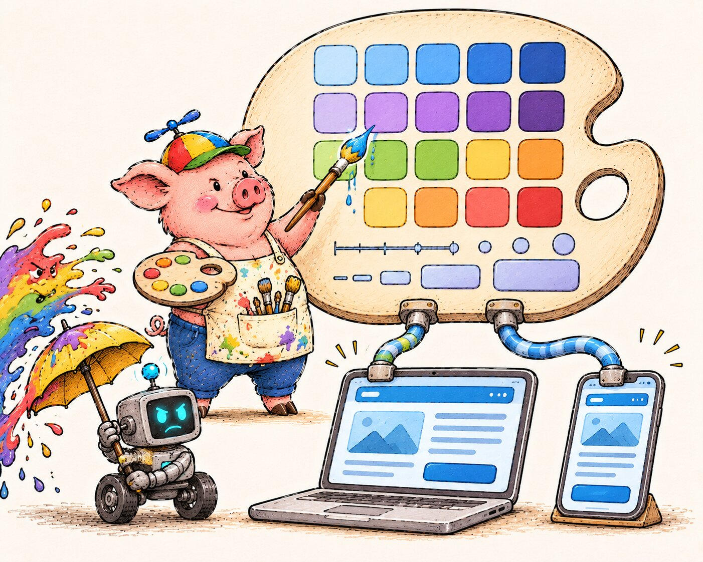

# Styles Management

  

A design system is not just a component library. It is a shared language between developers and designers, and it needs to be treated as a first-class part of the codebase.

Without a design system, teams end up with inconsistent spacing, slightly different colors across screens, and components that look similar but are not the same. This gets worse over time, and is expensive to fix later.

## Design Tokens

Design tokens are the foundation of the design system. They define the visual properties of the product: colors, typography, spacing, border radii, shadows. Everything else is built on top of them.

In this project, tokens live in a dedicated `design-tokens` package, authored as JSON and compiled to CSS custom properties and a JS module. Keeping them separate from components has a practical consequence: a designer can update the tokens directly without touching component code, and the change is reviewed on its own. How the pipeline works is described in [Design System](design-system.md#token-pipeline).

The same tokens are also shared across clients. A web app and a mobile app can both consume `design-tokens` and get identical color schemes, spacing scales, and typography rules. This is what keeps the product visually consistent when the same brand is present on multiple platforms.

## Tailwind CSS

Tailwind works by scanning the codebase for class names and including only the ones that are actually used in the final bundle. There is no stylesheet that grows unbounded as the project scales.

It also works well in AI-assisted development. Because styles are expressed as readable class names directly in the markup, an AI tool can understand and generate UI code accurately without needing to reason about a separate CSS file or a custom design system API.

The utility-first approach also avoids one of the common problems with component libraries: you are not locked into someone else's design decisions. Tailwind provides constraints through a consistent scale, but the design is yours.

## Why Accessibility Is in the Pipeline

Accessibility is often treated as a checkbox for edge cases. That framing is wrong.

Accessibility limitations are not limited to permanent disabilities. A person using a phone in bright sunlight has reduced contrast. A person with a broken arm is navigating with one hand. A person in a noisy environment cannot use audio. Designing for accessibility improves the experience for everyone.

There is also a legal dimension. In the United States, there are companies whose business model is to audit websites for accessibility violations and file lawsuits against those that fail to comply. Courts have consistently ruled in their favor, and settlements frequently reach six or seven figures. For any product with users in the US, accessibility is a financial risk, not just a quality concern.

How this is automated, with Storybook and axe-core, is described in [Design System](design-system.md#accessibility-testing).
